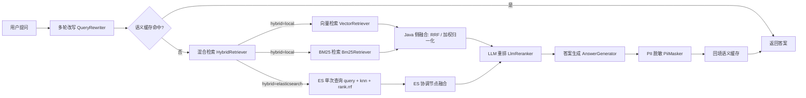

# his-rag

面向医院信息系统（HIS）的检索增强生成（RAG）服务。基于 **Spring Boot 3.2.5 + Java 17**，提供文档入库、混合检索、LLM 重排、答案生成、隐私脱敏、语义缓存与多轮对话能力，并内置**文档级访问控制**。

---

## 特性

- **文档解析入库**：支持 PDF（Apache PDFBox）与纯文本（txt / md / csv），自动识别文件类型，切片时按句末标点断句并保留重叠。
- **混合检索**：向量语义召回 + BM25 关键词召回。支持两种形态——**ES 原生混合检索**（文本与向量同索引，一次查询内完成召回与融合）与**本地两路召回 + Java 融合**（RRF / 加权归一化）。
- **可插拔存储后端**：混合检索支持 `local` / `elasticsearch`，BM25 支持 `memory` / `elasticsearch`，向量库支持 `memory` / `pgvector`，通过配置切换，**外部服务不可用时不阻断应用启动**。
- **LLM 重排**：对召回候选做 listwise 重排，解析失败自动降级为原始顺序。
- **语义缓存**：按查询向量余弦相似度命中，**按权限域隔离**，避免高权限答案泄漏。
- **多轮对话**：结合历史把带指代的追问改写为独立问题，任何异常都回退原问题。
- **隐私脱敏**：对身份证号、银行卡号、手机号、固话、邮箱做正则脱敏。
- **权限控制**：文档级 ACL（科室 / 角色 / 密级 / 公开），检索阶段统一过滤。
- **检索评估**：内置 Recall@K、Precision@K、MRR 指标。

---

## 架构

### 检索链路



> 两条路径最终都汇入同一个 `Retriever` 接口，`RagService` 无需感知后端差异。
> 权限过滤统一在 Java 侧完成（ES 路径下同样先过滤再截断），保证两种形态的 ACL 语义一致。

### 技术栈

| 组件 | 选型 |
|---|---|
| 框架 | Spring Boot 3.2.5 / Java 17 |
| 文档解析 | Apache PDFBox 2.0.37 |
| 混合检索 | ES 原生（`dense_vector` + `rank.rrf`）/ 本地两路召回 + Java 融合 |
| 向量库 | 内存（默认）/ PostgreSQL + pgvector |
| 关键词检索 | 内存倒排（默认）/ Elasticsearch 8.x |
| Embedding / LLM | 任意 OpenAI 兼容接口 |
| 构建 | Maven |

---

## 快速开始

### 环境要求

- JDK 17+
- Maven 3.6.3+
- （可选）Docker，用于启动 Elasticsearch / PostgreSQL

### 构建

```bash
git clone <repo-url> his-rag
cd his-rag
mvn clean package -DskipTests
```

### 零外部依赖启动

默认使用内存版向量库与 BM25 索引，**无需任何中间件**即可跑通全链路：

```bash
export RAG_EMBEDDING_API_KEY=sk-xxx
export RAG_LLM_API_KEY=sk-xxx
mvn spring-boot:run
```

启动后访问 <http://localhost:8080/api/rag/health> 应返回：

```json
{ "status": "UP", "service": "his-rag" }
```

> 若暂时没有 API Key，应用仍可正常启动，`/health`、`/stats`、`/cache/stats` 可用；只有涉及向量化与生成的接口会失败。

### 生产配置

#### 方案 A：Elasticsearch 单索引混合检索（推荐）

文本与向量同存一个索引，检索时由 ES 在**一次请求**内完成 BM25 + kNN 召回与融合，
应用侧无需维护两套存储、也无需在 Java 里做分数归一化。**只需要 Elasticsearch**。

```yaml
# docker-compose.yml
services:
  elasticsearch:
    image: docker.elastic.co/elasticsearch/elasticsearch:8.13.4
    ports: ["9200:9200"]
    environment:
      discovery.type: single-node
      xpack.security.enabled: "false"
      ES_JAVA_OPTS: "-Xms512m -Xmx512m"
```

```bash
docker compose up -d

export RAG_HYBRID_BACKEND=elasticsearch
export ES_URIS=http://localhost:9200
mvn spring-boot:run
```

启动时会自动创建索引 `his_rag_hybrid`，其中 `content` / `documentTitle` 为 `text`（走 BM25），
`embedding` 为 `dense_vector`（`similarity: cosine`，走 kNN）。

> ⚠️ `rag.hybrid.backend=elasticsearch` 时，`rag.vector.backend` 与 `rag.bm25.backend` **不再参与入库与检索**。
> 这是刻意的：避免同一份数据被写进两套存储、出现不一致。

#### 方案 B：pgvector + ES BM25 分离

```yaml
services:
  postgres:
    image: pgvector/pgvector:pg16
    ports: ["5432:5432"]
    environment:
      POSTGRES_PASSWORD: postgres
      POSTGRES_DB: his_rag

  elasticsearch:
    image: docker.elastic.co/elasticsearch/elasticsearch:8.13.4
    ports: ["9200:9200"]
    environment:
      discovery.type: single-node
      xpack.security.enabled: "false"
      ES_JAVA_OPTS: "-Xms512m -Xmx512m"
```

```bash
export RAG_VECTOR_BACKEND=pgvector
export RAG_BM25_BACKEND=elasticsearch
export ES_URIS=http://localhost:9200
export PG_URL=jdbc:postgresql://localhost:5432/his_rag
export PG_USER=postgres
export PG_PASSWORD=postgres
mvn spring-boot:run
```

应用启动时会自动：

- 执行 `CREATE EXTENSION IF NOT EXISTS vector`、建表、建 HNSW 索引；
- 创建 Elasticsearch 索引（不存在时）。

**中文检索建议**：Elasticsearch 安装 [IK 分词插件](https://github.com/infinilabs/analysis-ik) 后，把 `rag.hybrid.analyzer`（或方案 B 的 `rag.bm25.analyzer`）改为 `ik_max_word`，否则默认 `standard` 分词对中文效果较差。

---

## 配置说明

所有配置均可用环境变量覆盖（见括号内变量名）。

### 模型服务

| 配置项 | 默认值 | 说明 |
|---|---|---|
| `rag.embedding.base-url` | `https://api.openai.com/v1` | Embedding 接口地址（`RAG_EMBEDDING_BASE_URL`） |
| `rag.embedding.api-key` | 空 | （`RAG_EMBEDDING_API_KEY`） |
| `rag.embedding.model` | `text-embedding-3-small` | （`RAG_EMBEDDING_MODEL`） |
| `rag.embedding.dimension` | `1536` | 需与向量库维度一致 |
| `rag.embedding.batch-size` | `16` | 批量向量化条数 |
| `rag.llm.base-url` | `https://api.openai.com/v1` | Chat 接口地址（`RAG_LLM_BASE_URL`） |
| `rag.llm.api-key` | 空 | （`RAG_LLM_API_KEY`） |
| `rag.llm.model` | `gpt-4o-mini` | （`RAG_LLM_MODEL`） |
| `rag.llm.temperature` | `0.2` | 采样温度 |
| `rag.llm.max-tokens` | `1024` | 最大输出长度 |

### 存储后端

| 配置项 | 默认值 | 说明 |
|---|---|---|
| `rag.bm25.backend` | `memory` | `memory` / `elasticsearch`（`RAG_BM25_BACKEND`） |
| `rag.bm25.index-name` | `his_rag_chunks` | ES 索引名（`RAG_BM25_INDEX`） |
| `rag.bm25.analyzer` | `standard` | 建议 IK 装好后改 `ik_max_word`（`RAG_BM25_ANALYZER`） |
| `rag.vector.backend` | `memory` | `memory` / `pgvector`（`RAG_VECTOR_BACKEND`） |
| `rag.vector.table` | `his_rag_chunks` | pgvector 表名（`RAG_VECTOR_TABLE`） |
| `rag.vector.dimension` | `1536` | 必须与 embedding 维度一致（`RAG_VECTOR_DIMENSION`） |
| `rag.vector.index-type` | `hnsw` | `hnsw` / `ivfflat` / `none`（`RAG_VECTOR_INDEX`） |
| `spring.elasticsearch.uris` | `http://localhost:9200` | （`ES_URIS`） |
| `spring.datasource.url` | `jdbc:postgresql://localhost:5432/his_rag` | （`PG_URL`） |

> `spring.datasource.hikari.initialization-fail-timeout: -1` 是刻意设置的：数据库未启动时应用依然能起来，只在真正访问时失败。

### 混合检索

| 配置项 | 默认值 | 说明 |
|---|---|---|
| `rag.hybrid.backend` | `local` | `local` / `elasticsearch`（`RAG_HYBRID_BACKEND`） |
| `rag.hybrid.index-name` | `his_rag_hybrid` | ES 索引名（`RAG_HYBRID_INDEX`） |
| `rag.hybrid.dimension` | `1536` | 必须与 embedding 维度一致（`RAG_HYBRID_DIMENSION`） |
| `rag.hybrid.analyzer` | `standard` | 建议 IK 装好后改 `ik_max_word`（`RAG_HYBRID_ANALYZER`） |
| `rag.hybrid.fusion` | `rrf` | `rrf`=ES 原生 RRF（需 8.8+）；`knn`=两路 `_score` 加权求和（`RAG_HYBRID_FUSION`） |
| `rag.hybrid.knn-k` | `100` | kNN 每分片返回的候选数 |
| `rag.hybrid.num-candidates` | `200` | kNN 每分片探索的候选数，需 ≥ `knn-k` |
| `rag.hybrid.rank-constant` | `60` | RRF 平滑常数 |
| `rag.hybrid.window-size` | `100` | RRF 参与排序的窗口大小 |
| `rag.hybrid.text-boost` | `1.0` | 全文检索权重，仅 `fusion=knn` 生效 |
| `rag.hybrid.knn-boost` | `1.0` | 向量检索权重，仅 `fusion=knn` 生效 |

> `rag.hybrid.backend=elasticsearch` 时，`rag.bm25.*` 与 `rag.vector.*` 被忽略。
> `dimension` 与 `dense_vector` 强绑定，**建索引后不可修改**；换 embedding 模型时须删索引重建（`DELETE /api/rag/documents` 会重建索引）。

### 检索与生成

| 配置项 | 默认值 | 说明 |
|---|---|---|
| `rag.retrieval.vector-top-k` | `20` | 向量召回候选数 |
| `rag.retrieval.bm25-top-k` | `20` | BM25 召回候选数 |
| `rag.retrieval.candidate-top-k` | `30` | 送入重排的候选数 |
| `rag.retrieval.final-top-k` | `5` | 最终进入生成上下文的片段数 |
| `rag.retrieval.use-rrf` | `true` | `true`=RRF，`false`=加权归一化 |
| `rag.retrieval.rrf-k` | `60` | RRF 平滑常数 |
| `rag.retrieval.vector-weight` | `0.6` | 加权融合时向量权重 |
| `rag.retrieval.bm25-weight` | `0.4` | 加权融合时 BM25 权重 |
| `rag.retrieval.enable-rerank` | `true` | 是否启用 LLM 重排 |
| `rag.chunk.size` | `400` | 切片长度（字符） |
| `rag.chunk.overlap` | `80` | 相邻切片重叠长度 |

### 安全与对话

| 配置项 | 默认值 | 说明 |
|---|---|---|
| `rag.security.mask-pii` | `true` | 输出前是否脱敏 |
| `rag.cache.enabled` | `true` | 语义缓存开关 |
| `rag.cache.similarity-threshold` | `0.95` | 命中阈值（余弦相似度） |
| `rag.cache.ttl` | `30m` | 条目存活时间 |
| `rag.cache.max-size` | `1000` | 最大条目数，超出按最近访问淘汰 |
| `rag.conversation.enabled` | `true` | 多轮对话开关 |
| `rag.conversation.rewrite-enabled` | `true` | 是否启用查询改写 |
| `rag.conversation.max-history-turns` | `6` | 参与改写的最近对话轮数 |
| `spring.servlet.multipart.max-file-size` | `50MB` | 单文件上传上限 |

---

## API

所有接口以 `/api/rag` 为前缀。

| 方法 | 路径 | 说明 |
|---|---|---|
| `POST` | `/ingest` | JSON 批量入库（已解析的纯文本） |
| `POST` | `/ingest/file` | 上传 PDF / 纯文本文件入库（multipart） |
| `POST` | `/query` | 问答，支持多轮 `history` |
| `POST` | `/retrieve` | 仅检索，便于调试 |
| `POST` | `/eval` | 检索效果评估 |
| `GET` | `/stats` | 知识库与缓存统计 |
| `GET` | `/cache/stats` | 语义缓存统计 |
| `DELETE` | `/cache` | 清空语义缓存 |
| `DELETE` | `/documents` | 清空知识库（片段 / 向量 / 索引 / 缓存） |
| `GET` | `/health` | 健康检查 |

### 1. 文件入库

```bash
curl -X POST http://localhost:8080/api/rag/ingest/file \
  -F "file=@高血压诊疗指南.pdf" \
  -F "title=高血压诊疗指南" \
  -F "departments=心内科" \
  -F "roles=DOCTOR" \
  -F "sensitivityLevel=1"
```

响应：

```json
{
  "documentId": "doc-cc98f4fa-eb0f-46f1-a566-e9013d1d89ea",
  "fileName": "hypertension.pdf",
  "title": "高血压诊疗指南",
  "chunks": 1,
  "extracted": true
}
```

`extracted: false` 表示未提取到文本——通常是扫描件，需要 OCR 预处理。

### 2. JSON 入库

```bash
curl -X POST http://localhost:8080/api/rag/ingest \
  -H 'Content-Type: application/json' \
  -d '{
    "documents": [{
      "id": "doc-001",
      "title": "高血压诊疗指南",
      "content": "ACEI 类药物在妊娠期禁用……",
      "source": "guideline.pdf",
      "accessControl": {
        "departments": ["心内科"],
        "roles": ["DOCTOR"],
        "sensitivityLevel": 1,
        "publicAccess": false
      }
    }]
  }'
```

### 3. 多轮问答

```bash
curl -X POST http://localhost:8080/api/rag/query \
  -H 'Content-Type: application/json' \
  -d '{
    "query": "它的禁忌是什么？",
    "user": {
      "userId": "D001",
      "name": "张三",
      "departments": ["心内科"],
      "roles": ["DOCTOR"],
      "clearanceLevel": 1
    },
    "history": [
      { "role": "user", "content": "高血压常用哪些药？" },
      { "role": "assistant", "content": "常用 ACEI、ARB、CCB 等。" }
    ]
  }'
```

响应：

```json
{
  "query": "它的禁忌是什么？",
  "rewrittenQuery": "高血压常用药的禁忌症有哪些",
  "answer": "ACEI 类药物在妊娠期禁用…… [1]",
  "citations": [
    {
      "chunkId": "doc-001#0",
      "documentId": "doc-001",
      "documentTitle": "高血压诊疗指南",
      "chunkIndex": 0,
      "score": 1.0,
      "snippet": "ACEI 类药物在妊娠期禁用……"
    }
  ],
  "piiMasked": true,
  "cacheHit": false,
  "error": false,
  "latencyMs": 1834
}
```

字段说明：

- `rewrittenQuery`：多轮改写后实际用于检索的问题（未改写时与 `query` 相同）；
- `cacheHit`：是否命中语义缓存（命中时不调用检索与生成）；
- `error`：生成是否失败（失败结果不会写入缓存）。

### 4. 检索评估

```bash
curl -X POST http://localhost:8080/api/rag/eval \
  -H 'Content-Type: application/json' \
  -d '{
    "topK": 5,
    "cases": [
      { "query": "高血压用药禁忌", "relevantDocumentIds": ["doc-001"] },
      { "query": "糖尿病饮食", "relevantDocumentIds": ["doc-002"] }
    ]
  }'
```

返回 `avgRecall` / `avgPrecision` / `mrr` 与逐条明细。

### 5. 统计信息

```bash
curl http://localhost:8080/api/rag/stats
```

```json
{
  "chunks": 12,
  "vectors": 0,
  "bm25Documents": 0,
  "hybrid": {
    "enabled": true,
    "backend": "elasticsearch:his_rag_hybrid",
    "documents": 12
  },
  "cache": { "enabled": true, "size": 3, "hits": 5, "misses": 8, "hitRate": 0.385 }
}
```

`hybrid.enabled=true` 时，`vectors` / `bm25Documents` 为 0 是正常的——数据只写在 ES 混合索引里。
`rag.hybrid.backend=local` 时 `hybrid` 只有 `{"enabled": false}`，统计看 `vectors` 与 `bm25Documents`。

---

## 核心设计

### 权限模型

`AccessControl` 按四个维度约束可见性：

| 字段 | 含义 |
|---|---|
| `departments` | 允许访问的科室；为空表示不限 |
| `roles` | 允许访问的角色；为空表示不限 |
| `sensitivityLevel` | 最低密级，用户 `clearanceLevel` 须 ≥ 该值 |
| `publicAccess` | 对所有已登录用户公开 |

判定逻辑：`publicAccess` 直接放行 → 管理员放行 → 否则科室、角色、密级三者同时满足。检索器在打分后统一过滤，保证向量与 BM25 两条链路权限语义一致。

### 混合检索与融合

#### 形态一：ES 原生混合检索（`rag.hybrid.backend=elasticsearch`）

文本与向量同存一个索引，**一次请求**内完成两路召回与融合，等价于向 ES 发送：

```json
{
  "query": { "multi_match": { "query": "高血压用药禁忌", "fields": ["content^1.0", "documentTitle^1.5"] } },
  "knn": {
    "field": "embedding",
    "query_vector": [0.013, -0.221, "..."],
    "k": 100,
    "num_candidates": 200
  },
  "rank": { "rrf": { "rank_constant": 60, "window_size": 100 } },
  "size": 30,
  "_source": { "excludes": ["embedding"] }
}
```

相比 Java 侧融合，这样做的好处：

- **少一次网络往返**：不用先查向量库再查 BM25 再合并；
- **融合在数据所在节点完成**：只需回传最终 Top-K，而不是两路各回传几十条；
- **不搬向量**：`_source.excludes: embedding` 避免每次查询回传上千个浮点数；
- **两路天然对齐**：同一份 ACL、同一份切片，不存在两套存储的写入时序差异。

`fusion=rrf` 走 ES 8.8+ 的 `rank.rrf`，按排名倒数融合，对两路分数量纲不敏感；
`fusion=knn` 则不传 `rank`，由 ES 把 `query` 与 `knn` 两路 `_score` 加权求和，权重由 `text-boost` / `knn-boost` 控制。

#### 形态二：本地两路召回 + Java 融合（默认）

- **RRF（默认）**：`score = Σ weight / (k + rank)`，无需分数归一化，对两路分数量纲不敏感，稳健。
- **加权归一化**：各路分数 min-max 归一化后按权重求和，适合分数量纲已对齐的场景。

> 两条路径共用同一套 ACL 语义：**先按权限过滤，再截断到 topK**，避免过滤后候选不足。
> 因此检索时会先扩大候选窗口（`max(topK × 4, topK + 10)`）再过滤。

### 语义缓存的权限域隔离

语义缓存天然跨用户共享，直接复用会导致越权。因此缓存条目的 key 包含**权限域签名**：

```
admin                                  → 管理员独立域
anon                                   → 匿名独立域
lvl{密级}|d:{排序科室}|r:{排序角色}      → 普通用户按权限签名分域
```

**不同权限域即使问题完全相同也不共享缓存**。命中时返回深拷贝，避免调用方修改污染缓存。文档入库或清库会自动失效全部缓存。

### 降级策略

| 环节 | 失败时行为 |
|---|---|
| Elasticsearch 索引初始化 | 记录 error 日志，应用继续启动 |
| pgvector 初始化 | 记录 error 日志，应用继续启动 |
| ES 混合检索查询 | 记录 error 日志，返回空候选；上层按「无参考资料」作答 |
| Embedding 调用 | 抛异常；语义缓存侧则跳过缓存 |
| LLM 重排 | 回退为召回原始顺序 |
| 查询改写 | 回退为用户原始问题 |
| 答案生成 | 返回错误提示，`error=true`，结果不写缓存 |

设计原则：**任何外部依赖不可用都不应导致应用无法启动**。

---

## 项目结构

```
his-rag/
├── pom.xml
└── src/
    ├── main/
    │   ├── java/com/hospital/rag/
    │   │   ├── HisRagApplication.java
    │   │   ├── config/RagProperties.java
    │   │   ├── model/            AccessControl / UserContext / Document / Chunk
    │   │   │                     ScoredChunk / RagAnswer / ChatMessage
    │   │   ├── util/Tokenizer.java
    │   │   ├── embedding/        EmbeddingModel / OpenAiCompatibleEmbeddingModel
    │   │   ├── llm/              LlmClient / OpenAiCompatibleLlmClient
    │   │   ├── store/            ChunkStore / VectorStore
    │   │   │                     InMemoryVectorStore / PgVectorStore
    │   │   ├── ingest/           DocumentParser / PdfDocumentParser
    │   │   │                     PlainTextDocumentParser
    │   │   │                     TextSplitter / DocumentIngestionService
    │   │   ├── retrieve/         Bm25Index / InMemoryBm25Index / ElasticsearchBm25Index
    │   │   │                     HybridSearchIndex / ElasticsearchHybridIndex
    │   │   │                     Retriever / VectorRetriever / Bm25Retriever
    │   │   │                     HybridRetriever / Reranker / LlmReranker
    │   │   ├── cache/            SemanticCache / InMemorySemanticCache
    │   │   ├── rewrite/          QueryRewriter / LlmQueryRewriter
    │   │   ├── security/PiiMasker.java
    │   │   ├── generate/AnswerGenerator.java
    │   │   ├── service/RagService.java
    │   │   ├── eval/Evaluator.java
    │   │   └── controller/RagController.java
    │   └── resources/application.yml
    └── test/java/com/hospital/rag/
        ├── cache/InMemorySemanticCacheTest.java
        ├── ingest/DocumentIngestionServiceTest.java
        ├── ingest/PdfDocumentParserTest.java
        ├── ingest/PlainTextDocumentParserTest.java
        ├── retrieve/HybridRetrieverTest.java
        └── rewrite/LlmQueryRewriterTest.java
```

---

## 测试

```bash
mvn test
```

当前共 **33 个单元测试**，全部不依赖外部服务：

| 测试类 | 覆盖内容 |
|---|---|
| `InMemorySemanticCacheTest` | 相似命中、语义无关不命中、**跨科室/跨密级/管理员不泄漏**、失败结果不缓存、副本隔离、TTL/统计 |
| `LlmQueryRewriterTest` | 无历史跳过、正常改写、引号清理、多行截断、异常/空/超长回退 |
| `PdfDocumentParserTest` | 现场生成 PDF 再抽取、多页、无文本层、空白归一化 |
| `PlainTextDocumentParserTest` | 后缀识别、无后缀兜底、UTF-8 中文 |
| `HybridRetrieverTest` | **有混合索引时走 ES 路径且不碰本地索引**、ES 结果按 ACL 过滤、无索引时回退本地融合、空查询短路 |
| `DocumentIngestionServiceTest` | **混合模式下只写混合索引**、无混合索引时写向量库 + BM25 |

---

## 已知限制

- **扫描件 PDF 不支持**：PDFBox 只能提取文本层，纯图片 PDF 需要 OCR（如 Tesseract）预处理。
- **语义缓存为单机内存实现**：多实例部署时各自独立，需替换为 Redis 等共享存储。
- **ES 原生 RRF 需要 8.8+**：低版本只能用 `fusion=knn`（分数加权求和），或回退 `rag.hybrid.backend=local`。
- **ES 混合模式下 ES 是硬依赖**：查询失败只会得到空候选，不会自动回退到本地索引（本地索引在该模式下为空）。若需要容灾，请保持 `rag.hybrid.backend=local` 并使用 pgvector + ES BM25。
- **权限过滤在 Java 侧完成**：数据量大时可下推到 ES `bool` 查询或 SQL `WHERE`，减少无效回传。ES 混合模式同样如此，因此会先扩大候选窗口再过滤。
- **`dense_vector` 维度不可变**：切换 embedding 模型后必须重建索引。
- **中文分词依赖 IK**：Elasticsearch 默认 `standard` 分词对中文效果有限。

## Roadmap

- [ ] docx / xlsx 文档解析
- [ ] 扫描件 OCR 兜底链路
- [ ] 语义缓存 Redis 实现（多实例共享）
- [ ] Testcontainers 端到端集成测试
- [ ] 检索结果去重与多样性控制（MMR）
